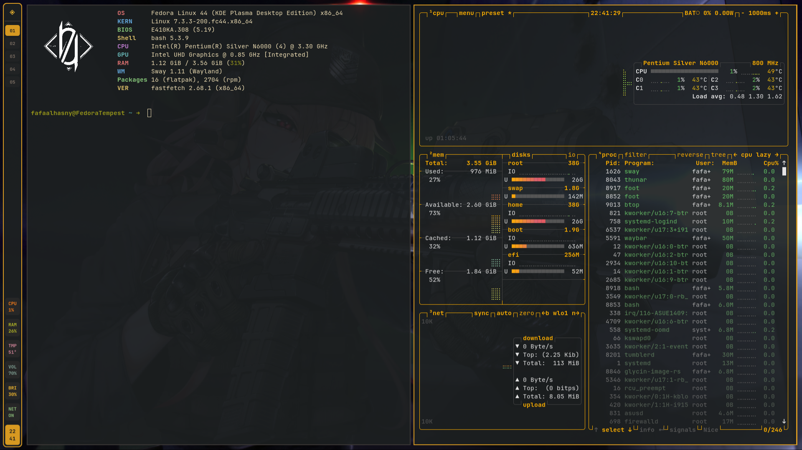
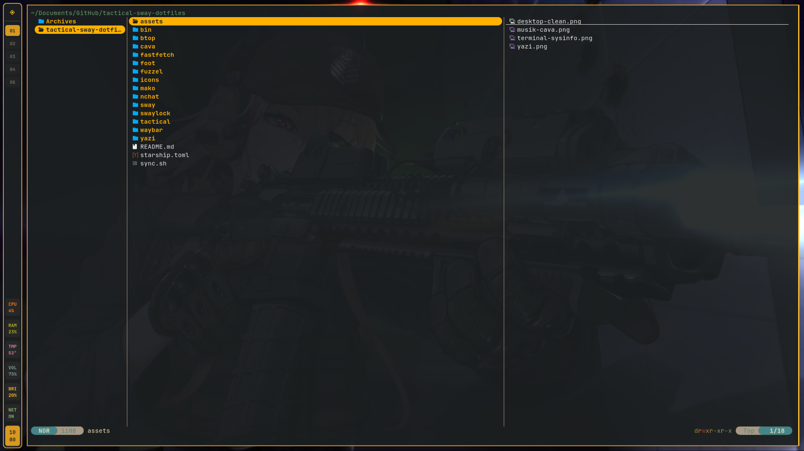
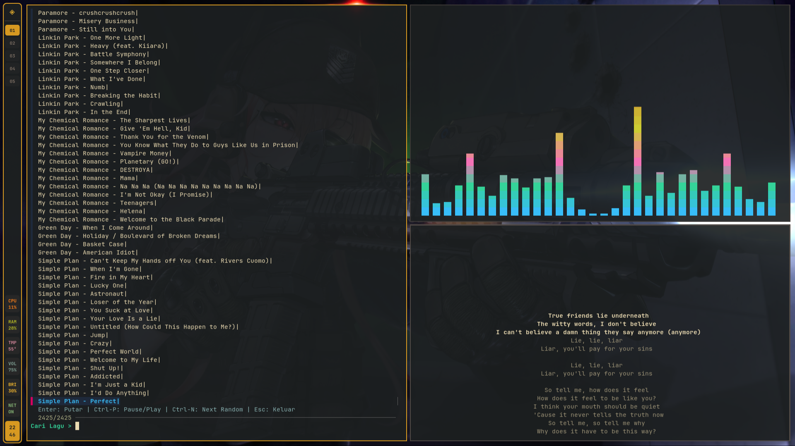

# Tactical Sway Dotfiles

A lightweight, keyboard-driven **Fedora Linux + Sway Wayland** desktop configuration tailored for low-memory hardware (4 GB RAM + `zram`) and a TUI-first workflow.


---

## Desktop Preview


| System Info (`fastfetch` + `btop`) | File Manager (`yazi`) | Music & Visualizer (`mpv` + `cava`) |
| :---: | :---: | :---: |
|  |  |  |

---

## Environment & Optimization

| Component | Details |
| :--- | :--- |
| **OS & Display** | Fedora Linux (Sway Wayland) |
| **Window Manager** | Sway + Swaylock + Mako |
| **Bar & Launcher** | Waybar + Fuzzel |
| **Terminal & Shell** | Foot + Starship + Yazi |
| **Comms & Audio** | `nchat` (WhatsApp TUI) + PipeWire + `mpv` + `sptlrx` + Cava |
| **Memory Tuning** | `zram` compression & lightweight TUI workflow for 4 GB RAM |

---

## Color Palette

| Role | Name | Hex | Preview |
| :--- | :--- | :--- | :--- |
| Background | Tactical Dark | `#141B1E` |  |
| Surface / Panel | Slate Charcoal | `#232A2D` |  |
| Primary Accent | Tactical Amber | `#E5C76B` |  |
| Secondary Accent | Warm Copper | `#E57474` |  |
| Foreground | Off White | `#DADADA` |  |

---

## Core Components

| Path | Component | Description |
| :--- | :--- | :--- |
| `sway/` | **Sway WM** | Window manager configuration, autostart, and helper scripts |
| `waybar/` | **Waybar** | Modular status bar with theme variants (`gruvbox`, `minimal`) |
| `foot/` | **Foot Terminal** | Lightweight Wayland terminal emulator with tactical color scheme |
| `fuzzel/` | **Fuzzel** | Wayland application launcher styled to match the desktop |
| `nchat/` | **nchat (WhatsApp)** | Custom keybindings and UI tweaks for terminal WhatsApp client |
| `btop/` | **btop++** | System resource monitor featuring custom `tactical-amber` theme |
| `yazi/` | **Yazi** | Fast terminal file manager with file previews |
| `mako/` | **Mako** | Wayland notification daemon |
| `swaylock/` | **Swaylock** | Custom lockscreen layout and assets |
| `fastfetch/` & `cava/` | **Aesthetics** | Custom system fetch info and terminal audio spectrum visualizer |
| `starship.toml` | **Starship Prompt** | Fast, minimal cross-shell prompt |
| `bin/` | **Custom Scripts** | Music player automation (`mpv` + `sptlrx`) and scratchpad utilities |

---

## Repository Structure

```text
tactical-sway-dotfiles/
├── assets/         # Desktop & TUI preview screenshots
├── sway/           # Sway WM config & helper scripts
├── waybar/         # Status bar config & stylesheets
├── foot/           # Terminal font, color scheme & behavior
├── fuzzel/         # Application launcher config
├── nchat/          # Terminal WhatsApp client keybindings & UI
├── btop/           # System monitor config & custom theme
├── yazi/           # TUI file manager config & keymaps
├── mako/           # Notification daemon config
├── swaylock/       # Lockscreen config & assets
├── fastfetch/      # System info fetch config & assets
├── cava/           # Audio spectrum visualizer config
├── icons/          # Bibata-Modern-Amber cursor theme
├── bin/            # Custom music & scratchpad automation scripts
├── starship.toml   # Shell prompt configuration
├── sync.sh         # Automated dotfiles sync script
└── README.md       # Repository documentation
```

---

## Automated Sync

Run the sync script whenever local changes in `~/.config/` are ready to be pushed to GitHub:

```bash
~/Documents/GitHub/tactical-sway-dotfiles/sync.sh "commit message"
```
